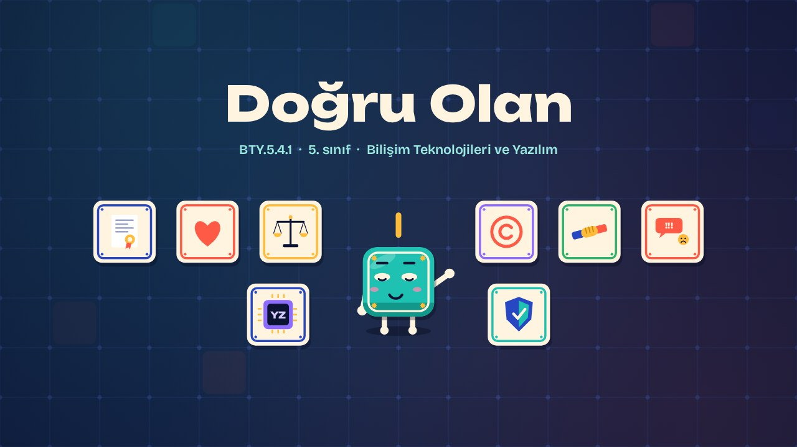
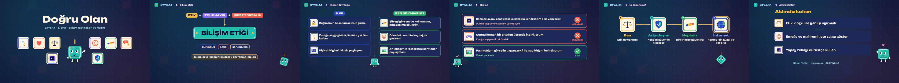

# Doğru Olan · The Right Thing

**▶ Tarayıcıda izleyin / Watch in the browser:** https://hakanatas.github.io/dogru-olan/ 
**⬇ MP4 + altyazılar / MP4 + subtitles:** [Releases](https://github.com/hakanatas/dogru-olan/releases) 
**✎ Kullanılan istem / The prompt behind it:** [PROMPT.md](PROMPT.md) 
**🎞 Bütün filmler / All films:** [Bilişim Filmleri](https://hakanatas.github.io/bilisim-filmleri/?sinif=5)

> **TR —** 5. sınıf Bilişim Teknolojileri ve Yazılım dersinin "Bilişim Etiği ve Siber Güvenlik" temasındaki BTY.5.4.1 öğrenme çıktısı için hazırlanmış, tamamen JavaScript ile çizilen 2,1 dakikalık animasyon; ses efektleri ve hafif fon müziği de kodla üretilir. Etik kavramı günlük bir senaryoyla açılır ve bilişim etiğine bağlanır; telif hakkı, siber zorbalık ve kişisel bilgilere saygı temel kavramlar olarak tanıtılır. Bilişim etiği ilkeleri öğrencinin günlük hayatındaki davranışlara dönüştürülür. Yapay zekâ ile ödev yapmak, lisanssız yazılım indirmek ve izinsiz fotoğraf paylaşmak gibi senaryolar etik açıdan değerlendirilir. Son olarak etik davranmanın neden önemli olduğu bir neden-sonuç zinciriyle yeniden ifade edilir. Altyazılar Türkçe, İngilizce ya da ikisi birlikte seçilebilir.

A 2.1-minute animation, with code-generated sound, for **5th-grade IT and Software** (Türkiye Yüzyılı Maarif Modeli). Ethics is introduced through an everyday dilemma and linked to information ethics (copyright, cyberbullying, respecting personal data); principles become daily habits; scenarios with AI homework, pirated software and shared photos are judged; and why ethics matters is restated as a chain of consequences. The guide is **Karo**, a living glazed tile who never speaks: he tells the story with his face, his arms and the blinking cursor above his head.

## Öğrenme çıktısı · Learning outcome

MEB, Türkiye Yüzyılı Maarif Modeli, Bilişim Teknolojileri ve Yazılım Dersi Öğretim Programı, 5. sınıf, 4. tema "Bilişim Etiği ve Siber Güvenlik":

**BTY.5.4.1. Bilişim etiği kural ve ilkelerini yorumlayabilme**
- a) Bilişim etiği ile ilgili temel kavramları inceler.
- b) Bilişim etiği kural ve ilkelerini bağlamdan kopmadan günlük hayatta kullanılacak şekilde dönüştürür.
- c) Bilişim etiği kural ve ilkelerine uygun davranmanın önemini yeniden ifade eder.

## Sahneler · Scenes

| # | Zaman | Sahne | Ne oluyor | Çıktı |
|---|---|---|---|---|
| 1 | 0:00–0:16 | Giriş |  |  |
| 2 | 0:16–0:46 | Bilişim etiği | Etik, telif hakkı, siber zorbalık ve bilişim etiği. | a |
| 3 | 0:46–1:08 | İlkeden davranışa | Bilişim etiği ilkeleri günlük hayattaki davranışlara dönüştürülür. | b |
| 4 | 1:08–1:33 | Etik mi? | Yapay zekâ, yazılım ve paylaşım senaryoları etik açıdan değerlendirilir. | b, c |
| 5 | 1:33–1:51 | Neden önemli? | Etik davranmanın önemi bir neden-sonuç zinciriyle ifade edilir. | c |
| 6 | 1:51–2:07 | Aklında kalsın |  |  |

## Çalıştırma · Running it

- **Önizleme:** `index.html` dosyasına çift tıklayın (çevrim dışı da çalışır). Klavye: boşluk oynat/duraklat, ← → 3 sn, Home başa. Adrese `?altyazi=en`, `?bicim=vertical` ya da `?ses=0` eklenebilir.
- **MP4:** bir kez `npm install`, sonra `npm run export -- --format=both --captions=tr` (720p yatay ve dikey, sesli). Google Chrome yüklüyse Playwright onu kullanır (`channel: 'chrome'`); ffmpeg gerekir.
- **Altyazı ve seslendirme notları:** `npm run srt` → `out/dogru-olan_tr.srt`, `_en.srt`, `_tr-en.srt`, `_seslendirme-notlari.txt`.
- **Sürüm dosyaları:** `npm run release` → `release/` klasöründe v1.0'ın 6 dosyası.
- **Yazı kontrolü:** `npm run check` yatay ve dikey düzende, üç altyazı seçeneğiyle üst üste binen, kenardan taşan ya da 720p'de 17 pikselden küçük kalan yazı arar.
- **Düzenleme:** senaryo (sahneler, altyazılar, seslendirme notları) `scenes/film.js` içindedir; değiştirince `npm run build` süreleri, `captions.js` ve `film.config.js` dosyalarını yeniden üretir. Sahne şablonları `src/kit/`, Karo `src/draw/karo.js`, ses `src/audio/synth.js`.

Her kare `renderFrame(t)` ile zamanın saf fonksiyonu olarak çizilir; rastgelelik tohumludur, MP4 ekran kaydı değil kare kare üretimdir. Ses de dosyadan çalınmaz: aynı olay listesinden hesaplanır. Yazı tipleri: Unbounded ve Bricolage Grotesque (SIL OFL 1.1), dosyaya gömülü.

## Lisans · License

**TR —** Bu film ve kodu [Creative Commons Atıf-GayriTicari 4.0 Uluslararası (CC BY-NC 4.0)](https://creativecommons.org/licenses/by-nc/4.0/deed.tr) lisansıyla paylaşılır. Ticari olmayan her amaçla (derste, okulda, eğitim materyalinde) kopyalayabilir, paylaşabilir ve değiştirebilirsiniz; ancak **kaynak göstermek zorunludur**: eser sahibinin adı ve bu deponun bağlantısı belirtilmeden kullanılamaz. Ticari kullanım (satış, ücretli ürün ya da yayın) için izin alınmalıdır.

**EN —** This film and its code are licensed under [Creative Commons Attribution-NonCommercial 4.0 International (CC BY-NC 4.0)](https://creativecommons.org/licenses/by-nc/4.0/). You may copy, share and adapt them for non-commercial purposes, but **attribution is required**: they may not be used without crediting the author and linking to this repository. Commercial use requires permission.

Atıf örneği / Required credit: *“Doğru Olan”, Hakan Ataş, Bilişim Filmleri — https://github.com/hakanatas/dogru-olan — CC BY-NC 4.0*
